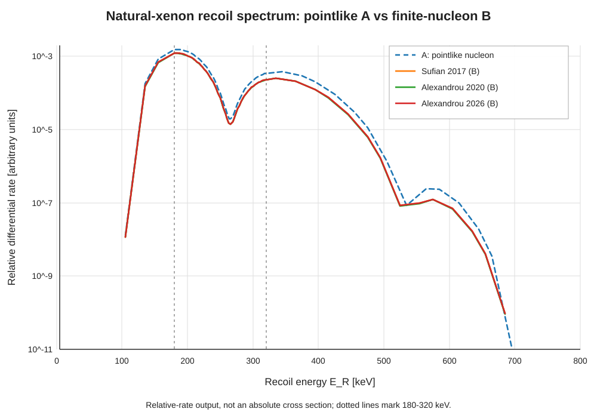
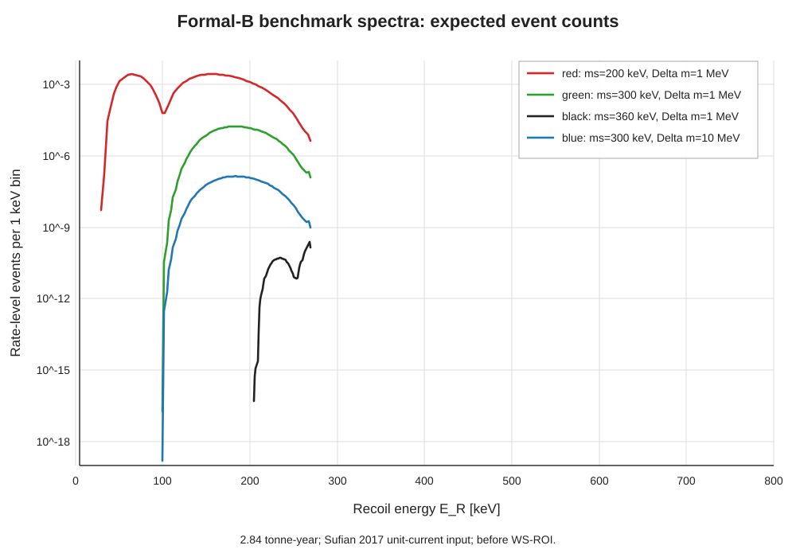

# Formal-B xenon recoil spectra and LZ event spectra

**Project:** LZ-3-body-for-hdm  
**Date:** 2026-11-20  
**Status:** plots archived from the local, checksum-verified B reweighting and event-weighted NEST fold.

## Figure 1 — Natural-xenon differential recoil spectrum

The curves compare the pointlike-nucleon A input with the three finite-nucleon B strange-current scenarios. The dotted vertical lines mark the 180–320 keV candidate interval.

**Normalization:** the PR86 halo source is stored in relative-rate units. This plot therefore shows a relative differential recoil rate (arbitrary normalization), not an absolute \(d\sigma/dE_R\) in physical cross-section units. The finite-nucleon B/A suppression is meaningful and is unchanged by the common overall normalization.

Source: PR86 high-order seven-isotope halo artifact, workflow run 44655861356; formal-B reweight outputs for Sufian 2017, Alexandrou 2020, and Alexandrou 2026.

## Figure 2 — Expected events per recoil-energy bin

The curves show the four benchmark spectra for the Sufian 2017 unit-current input, AFH-7 response, and eft2024 NEST response family. The ordinate is the rate-level expected event count in each 1 keV recoil bin for an exposure of 2.84 tonne-year:
\[
N_i = \left(\int_{E_i}^{E_i+1\,\mathrm{keV}}\frac{dR}{dE_R}\,dE_R\right)
(2.84\times10^3\,\mathrm{kg})(365.25\,\mathrm{day}).
\]
These are raw rate-level counts before the WS-ROI cut. The NEST response sample has unit weighted NEST acceptance over the nonzero support of these four benchmark spectra; WS-ROI acceptance is a separate subsequent selection.

Benchmark labels preserve the color names used in the benchmark definition:
- red: \(m_s=200\) keV, \(\Delta m=1\) MeV;
- green: \(m_s=300\) keV, \(\Delta m=1\) MeV;
- black: \(m_s=360\) keV, \(\Delta m=1\) MeV;
- blue: \(m_s=300\) keV, \(\Delta m=10\) MeV.

Source: PR87 formal-B artifact and local event-weighted NEST output; exposure 2.84 tonne-year.

## Reproducibility

| File | SHA-256 |
|---|---|
| natural_xenon_rate_vs_recoil_B.svg | df2db0d46e0ec296e2decd4ed030eda6085bbcd3b4136160dbf3a01d2fd36c5c |
| B_expected_events_vs_recoil_energy.svg | 6752761183309577279646cf6db997fbc484479038d4892b755b88d82e503563 |

The underlying numeric CSV outputs and their SHA256SUMS files are retained in the PR86 and PR87 workflow artifacts. The SVGs are vector versions for direct viewing and paper-layout work.
